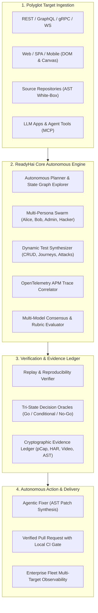
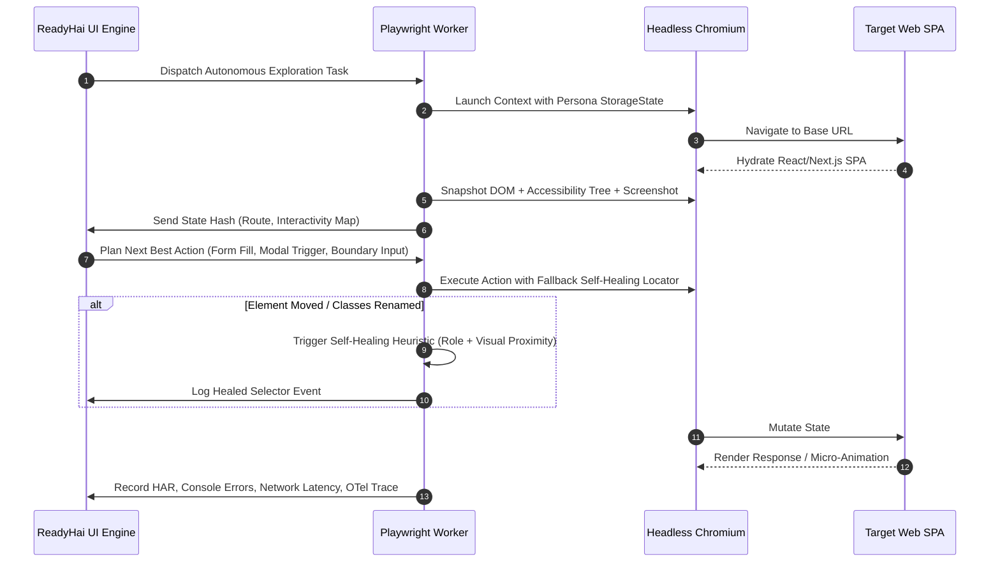
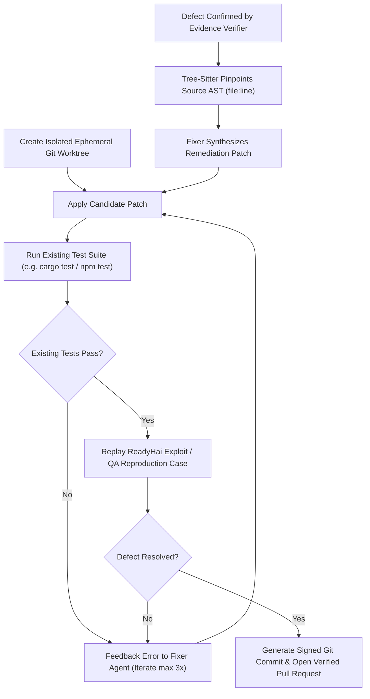
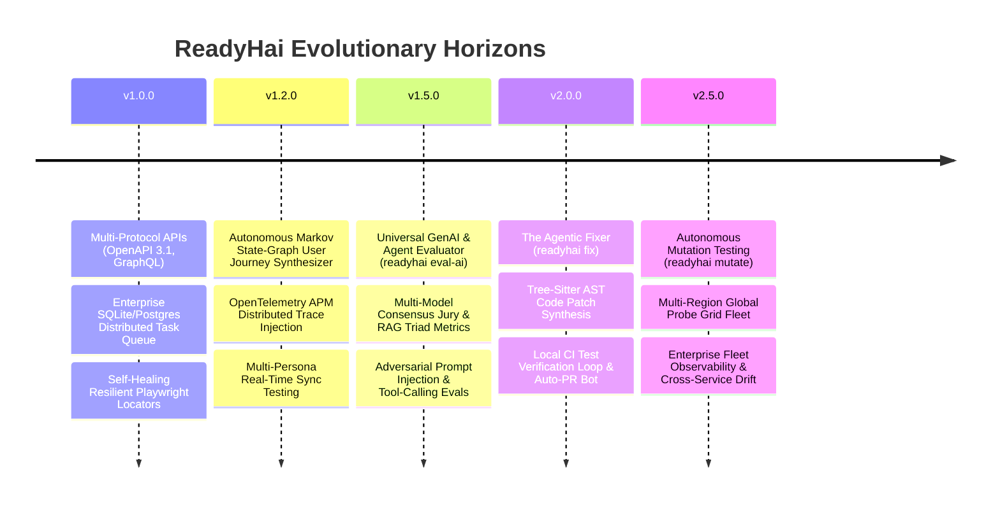

# ReadyHai: Strategic Master Plan for the World-Class Evaluator & QA Testing Engine

**Document Version:** 1.0.0  
**Target Architecture:** ReadyHai v1.0.0 – v2.5.0  
**Author:** Software Architecture & QA Quality Council (DeepMind Antigravity)  
**Date:** November 14, 2026  
**Scope:** Functional QA, Security (DAST/SAST/IAST), Performance, Resilience, GenAI Evaluation, Mutation Testing, and Autonomous Remediation  

---

## 1. Executive Vision: The "World-Class" Standard

### 1.1 The Problem in Modern Quality Engineering
Software engineering has fractured quality assurance across disjointed, incompatible silos:
- **Functional UI QA**: Playwright/Cypress/Selenium scripts that break on every minor DOM class change and require constant maintenance.
- **API Fuzzing**: Static Postman collections or isolated Schemathesis/RESTler tools that lack stateful cross-role context (BOLA/IDOR blind spots).
- **Security Testing**: High-noise SAST/DAST scanners (Snyk, SonarQube, Burp) that flood developers with unverified theoretical vulnerabilities.
- **AI/LLM Evaluation**: Disconnected prompt evaluators (Ragas, TruLens, DeepEval) that test LLM outputs in isolation without testing how LLMs interact with real backends, databases, and APIs.
- **Remediation**: Passive dashboards that report bugs but require developers to spend hours diagnosing root causes, reproducing errors, and writing patches.

### 1.2 The ReadyHai Singularity
To become the **undisputed #1 Evaluator and QA Testing Platform in the world**, ReadyHai must unify these fragmented disciplines into a **single, self-healing, evidence-grounded autonomous quality intelligence**.

ReadyHai will not simply be "another testing tool." It will be:
1. **The Universal Evaluator**: Capable of evaluating traditional microservices, dynamic single-page web applications, native Android binaries, distributed event meshes, and GenAI/LLM-powered agent workflows.
2. **The Autonomous Quality Synthesizer**: Capable of crawling, learning, and synthesizing multi-step user journeys, stateful API sequences, and boundary stress tests with zero prior configuration.
3. **The Interactive IAST Bridge**: Correlating frontend user interactions, API payloads, distributed OpenTelemetry traces, and AST source code lines into an immutable Evidence Ledger.
4. **The Agentic Fixer**: Closing the loop from *Defect Detected* to *Verified Green Pull Request*—synthesizing AST patches, validating them against local test suites, and delivering clean, ready-to-merge remediation.



---

## 2. Competitive Landscape & Capability Gap Analysis

| Capability Dimension | ReadyHai (Current v0.9.0) | Datadog Synthetics | Playwright / TestRigor | Snyk / Aikido | Ragas / DeepEval | **ReadyHai World-Class (Target v2.5)** |
|---|---|---|---|---|---|---|
| **Multi-Target Scope** | Repo, Image, Web, SSH, Android | Web & API only | Web (+ Mobile in some) | Repo, Cloud, Image | LLM Prompts only | **Repo, Image, Web, SSH, Android, LLM Agents & Microservice Mesh** |
| **API Protocol Breadth** | OpenAPI 3.x REST | REST | Scripted REST | REST (SCA only) | None | **OpenAPI 3.1, GraphQL, gRPC, WebSockets, SSE, Kafka** |
| **Autonomous Journey Discovery** | Single-page crawl + YAML journeys | None (Manual recorder) | NLP / AI Prompt-driven | None | None | **Self-Directed Visual State-Graph Crawler + Multi-Persona Workflows** |
| **Self-Healing Locators** | Standard CSS / XPath selectors | None | AI locator repair | None | None | **Multi-Attribute Fallback Trees + Visual Embedding Alignment** |
| **BOLA / IDOR Deep Detection** | 2-Role Cross-Replay (Strong) | None | None | Basic SAST taint | None | **Multi-Tenant State Graph with Automatic Token & Data Isolation Fuzzing** |
| **GenAI / LLM App Evaluation** | Basic LLM integration in agent | None | None | Prompt injection scan | Evaluation metrics | **RAG Triad, Multi-LLM Consensus Jury, Tool-Call Schema & Safety Benchmarking** |
| **Deep APM / Trace Linkage** | AST file:line source linkage | Metric alerts | Trace viewer | Code line only | Trace spans | **Direct OTel traceparent Injection -> Microservice Spans & SQL Query Pinpoint** |
| **Test Suite Mutation Efficacy** | None | None | None | None | None | **Cargo-mutants, Mutmut & Stryker Integration with Mutation Scoring** |
| **Automated Fix PR Synthesis** | Remediation guidance text only | None | None | Snyk Fix (Template PR) | None | **AST-Grounded Auto-Patching Verified by Replay Tests Before PR Creation** |
| **Air-Gapped & Offline Safety** | 100% Offline Bundle (Verified) | SaaS only | Open-source core | Cloud SaaS | Python Lib | **Full Self-Hosted Air-Gapped Stack with On-Prem LLM / vLLM Inference** |
| **Scale & Execution Mesh** | In-memory single worker | Distributed cloud | Grid runners | Cloud queue | CLI script | **Postgres/Redis Distributed Task Matrix with Multi-Region Probes** |

---

## 3. The 7 Architectural Pillars

### Pillar 1: Multi-Protocol API & Stateful Contract Fuzzer

#### Current Status in v0.9.0
`src/qa/api/` handles OpenAPI 3.0 REST endpoints, boundary parameters, 2-role BOLA verification, response schema validation, and error leak detection.

#### Enhancements to Achieve World-Class Status
1. **OpenAPI 3.1 & JSON Schema Draft 2020-12 Support**:
   - Upgrade parser in `src/qa/api/plan.rs` to support `prefixItems`, `unevaluatedProperties`, and complex polymorphic discriminators (`anyOf`/`oneOf`).
2. **GraphQL Introspection & Autonomous Query/Mutation Synthesizer**:
   - Add `src/qa/graphql/` module.
   - Execute GraphQL schema introspection (`__schema { types, queries, mutations, subscriptions }`).
   - Synthesize valid queries up to depth 5 with boundary inputs.
   - Detect deep query nesting DoS vulnerabilities (circular references like `user { friends { friends { friends } } }`).
   - Audit GraphQL Field-Level Authorization (querying sensitive private fields across unprivileged tokens).
3. **gRPC & Protobuf Reflection Fuzzer**:
   - Add `src/qa/grpc/` engine powered by `tonic` and `prost-reflect`.
   - Discover gRPC services via Server Reflection Protocol (`grpc.reflection.v1alpha.ServerReflection`).
   - Automatically fuzz protobuf message boundaries, numeric overflows, and stream cancellation leaks.
4. **Real-Time Streaming Protocols (WebSockets & Server-Sent Events)**:
   - WebSocket state machine testing (`src/qa/streaming/`): connection handshake, token expiry re-authentication, heartbeat/ping-pong resilience, and frame payload fuzzing.
   - SSE reconnection tests: ensuring event stream resumes at `Last-Event-ID` without event dropping or memory bloat.
5. **Stateful Dependency Graphing & Data Lineage (CRUD Lifecycle 2.0)**:
   - Build a topological resource dependency graph (e.g. `POST /organizations` -> `POST /projects` -> `POST /environments` -> `POST /deployments`).
   - Automatically harvest dynamic outputs from collection lists to populate deep nested path parameters without manual seeding.

---

### Pillar 2: Autonomous Multi-Step User Flow Synthesizer & Vision Engine

#### Current Status in v0.9.0
`src/qa/ui.rs` and `runners/playwright/qa.mjs` execute single-page crawling, basic form input validation, axe-core a11y, viewport responsiveness, and scripted YAML journeys.

#### Enhancements to Achieve World-Class Status
1. **Dynamic Markov State-Graph Crawler (`Autonomous Journey Synthesizer`)**:
   - Instead of static scripted journeys, the Playwright agent explores the target SPA like a human tester.
   - Computes state hashes from visible DOM trees, current route URL, and modal dialog states.
   - Constructs a directed graph of UI transitions: `State_A (Login)` --click--> `State_B (Dashboard)` --open--> `State_C (Settings Modal)`.
   - Identifies unreachable views, dead-end states, and broken navigation loops.
2. **Multi-Persona Collaborative Testing**:
   - Simultaneous multi-browser execution to test real-world multi-user interactions:
     - **Persona A (Admin)** modifies permission or revokes user session.
     - **Persona B (Member)** attempts action in another browser window concurrently.
     - Verifies WebSocket/real-time state synchronization, instant lockouts, and cache invalidation.
3. **Self-Healing Resilient Locators**:
   - Eliminate test fragility caused by CSS class changes, Tailwind re-indexing, or framework hydration.
   - Implement **Fallback Locator Trees**:
     1. Semantic accessibility role + name (`getByRole('button', { name: 'Submit' })`).
     2. Stable test attributes (`data-testid`, `data-qa`).
     3. DOM text content + neighboring anchor heuristic.
     4. Visual bounding box + spatial coordinate proximity.
   - When a locator breaks during UI changes, the self-healing engine locates the intended element using topological similarity and visual embeddings, logs the healed selector, and prevents test failure.
4. **Visual Regression 2.0 with Dynamic Masking**:
   - Automatically detect and mask dynamic visual noise: timestamps, animated SVG loaders, user avatars, randomly generated IDs, and carousels.
   - Multi-DPI pixel comparison with structural similarity index (SSIM) rather than naive pixel diffing, preventing false positives from font anti-aliasing differences across platforms.
5. **Automated Accessibility Testing (WCAG 2.2 Level AAA)**:
   - In addition to static axe-core rules, perform active keyboard focus trap validation (Tab, Shift-Tab, Enter, Escape navigation loops), screen-reader ARIA live region assertion, and color contrast under dark/light modes.



---

### Pillar 3: Universal GenAI & Agent Evaluator (The AI-Native Quality Engine)

#### Current Status in v0.9.0
The agent uses an LLM for exploratory planning and white-box security analysis, but ReadyHai does not yet evaluate customer LLM applications.

#### Enhancements to Achieve World-Class Status
As organizations deploy AI agents, RAG systems, and LLM-powered services, ReadyHai will introduce **`readyhai eval-ai`**—the industry's first enterprise-grade, deterministic GenAI evaluator.

1. **RAG Quality Triad & Groundedness Metrics**:
   - **Context Relevance**: Measures whether retrieved vector chunks are strictly relevant to the user query without clutter.
   - **Faithfulness / Groundedness**: Mathematically verifies that every claim in the LLM response is supported by the retrieved context (hallucination detection).
   - **Answer Relevance**: Ensures the generated answer directly addresses the user query without extraneous drift.
2. **Multi-Model Consensus Jury (Jury-as-a-Judge)**:
   - A single LLM judge has inherent model bias (e.g. GPT-4 favors OpenAI formatting; Claude favors Anthropic style).
   - ReadyHai implements a **Multi-Model Jury**:
     - Evaluates responses across an ensemble of heterogeneous models (e.g., Claude 3.7 Sonnet, GPT-4o, Gemini 2.5 Flash, DeepSeek V3, and local Llama 3.3).
     - Computes inter-annotator agreement (Cohen's Kappa / Fleiss' Kappa) and derives a statistically calibrated consensus score.
     - Outliers and high-variance judgments are flagged for human-in-the-loop audit.
3. **Agent Trajectory & Tool-Calling Evaluation**:
   - When evaluating AI agents (e.g., LangGraph, CrewAI, AutoGen, or custom MCP agents):
     - **Trajectory Efficiency**: Evaluates whether the agent reached the goal in the optimal number of steps without cyclic loops or repeated queries.
     - **Tool Schema Conformance**: Validates tool input arguments against JSON schemas.
     - **State Consistency**: Checks whether intermediate tool results match expected environmental states.
4. **Autonomous AI Red-Teaming & Security Evaluation**:
   - **Indirect Prompt Injection**: Injects canary payloads into web pages, documents, and API responses processed by the target LLM.
   - **Jailbreak Robustness**: Automated adversarial attacks (PAIR, GCG, Base64 obfuscation, multi-turn persuasion) against target conversational endpoints.
   - **System Prompt Extraction & Sensitive Data Exfiltration Fuzzing**.
5. **Cost, Latency & Token Efficiency Profiling**:
   - Tracks time-to-first-token (TTFT), tokens-per-second, and estimated monetary cost per query across model revisions to catch prompt inflation regressions.

---

### Pillar 4: Interactive IAST & OpenTelemetry Distributed Trace Correlation

#### Current Status in v0.9.0
Black-box HTTP probing is correlated with static AST source-sink paths when `--repo` is passed. However, live runtime microservice executions are invisible to the test runner.

#### Enhancements to Achieve World-Class Status
1. **W3C Trace Context Propagation**:
   - Every probe, fuzz request, and user journey action issued by ReadyHai injects standard W3C distributed tracing headers:
     ```http
     traceparent: 00-4bf92f3577b34da6a3ce929d0e0e4736-00f067aa0ba902b7-01
     tracestate: readyhai=run_id:rh_8fbf7b9,case_id:api_bola_042
     baggage: readyhai.target=user-service,readyhai.phase=fuzz
     ```
2. **Live OpenTelemetry APM Collector**:
   - ReadyHai embeds an in-process or sidecar OTLP receiver (gRPC `:4317` / HTTP `:4318`) or queries existing enterprise backends (Jaeger, Tempo, Datadog, Honeycomb).
   - When a test case causes a 500 error, slow latency (>1000ms), or database deadlock:
     - ReadyHai extracts the exact `trace_id`.
     - Pulls all spans across distributed microservices (e.g. Gateway -> Auth Service -> PostgreSQL).
     - Extracts the precise database query (e.g. unindexed `SELECT * FROM orders WHERE user_id = ...`) or unhandled exception stack trace.
3. **Runtime Interactive Application Security Testing (IAST)**:
   - Validates whether input sanitizers actually executed inside the runtime engine.
   - Eliminates false positives: if an injection payload reached an API parameter but the database driver used parameterized queries (verified in the OTel DB span), ReadyHai records it as safely sanitized rather than reporting a false alarm.

---

### Pillar 5: The Agentic Fixer (Verified AST Patch Synthesis & Auto-PRs)

#### Current Status in v0.9.0
ReadyHai outputs detailed triage reports, curl reproduction commands, and labeled example guidance in `src/agent/triage.rs` and `src/report.rs`.

#### Enhancements to Achieve World-Class Status
The leap from "reporting bugs" to "fixing bugs autonomously" is the ultimate competitive moat. ReadyHai introduces the **Fixer Engine (`readyhai fix`)**:

1. **AST-Grounded Code Patching**:
   - Leverages tree-sitter AST parsing (`src/agent/whitebox.rs`) to pinpoint the exact function, route handler, or authorization middleware responsible for the defect.
   - Synthesizes minimal, idiomatic code modifications adhering to project coding standards (Rust, TypeScript/JavaScript, Python, Go, Java, PHP).
2. **Deterministic Verification Loop (Test-Before-PR)**:
   - A generated fix is **never** offered blindly.
   - ReadyHai executes a 3-step local verification sandbox:
     1. Applies the patch to an isolated working tree / git branch.
     2. Runs existing project unit/integration tests to guarantee zero regressions.
     3. Replays the exact ReadyHai reproduction test case (curl / Playwright script) to verify the defect is 100% resolved.
3. **Automated Pull Request Generation**:
   - Opens a GitHub/GitLab Pull Request containing:
     - Clean, focused git commit.
     - Markdown summary detailing the root cause, defect severity, and the patch mechanism.
     - Evidence Ledger attachment: before-and-after reproduction logs and local test execution proofs.
     - Pre-configured CI status check integration.



---

### Pillar 6: Mutation Testing & Oracle Calibration (Evaluating the Tests)

#### Current Status in v0.9.0
`readyhai eval` runs 10 deterministic suites against seeded-bug fixtures to score recall, precision, and pass^k for ReadyHai's own engine.

#### Enhancements to Achieve World-Class Status
To evaluate customer applications and their test suites, ReadyHai will introduce **Autonomous Mutation Testing (`readyhai mutate`)**:

1. **Source Code Mutation Engine**:
   - Integrates with native language mutators (`cargo-mutants` for Rust, `Stryker` for TypeScript/JavaScript, `mutmut` for Python, `infection` for PHP).
   - Injects targeted semantic bugs into customer source code:
     - Inverting conditionals (`if x > 0` -> `if x <= 0`).
     - Modifying return values (`return Ok(true)` -> `return Ok(false)`).
     - Bypassing authorization guards (`if !user.is_admin` -> `if false`).
     - Nullifying database write operations.
2. **Mutation Score & Test Suite Calibration**:
   - Executes the customer's test suite against each mutant.
   - **Killed Mutant**: The customer's test failed (Good — test caught the bug).
   - **Survived Mutant**: The customer's test passed despite the injected defect (Critical Quality Gap — tests are superficial or missing assertions).
   - Generates an actionable **Mutation Coverage Heatmap**.
3. **Autonomous Negative Test Generation**:
   - For every survived mutant, ReadyHai automatically writes a new, minimal unit or integration test that kills the mutant, continuously increasing the application's true test coverage.

---

### Pillar 7: Enterprise Distributed Execution Mesh & Fleet Intelligence

#### Current Status in v0.9.0
The server (`src/serve.rs`) uses an in-memory single-worker queue with file-based persistence.

#### Enhancements to Achieve World-Class Status
1. **High-Performance Distributed Task Mesh**:
   - Replace in-memory single-worker queue with a pluggable distributed queue:
     - **Embedded mode**: SQLite with WAL mode + background thread pool for single-node setups.
     - **Enterprise mode**: PostgreSQL (`pg_cron` / `LISTEN/NOTIFY` / SKIP LOCKED worker queues) or Redis Streams / NATS.
   - Allows dozens of worker nodes to execute test suites concurrently across large enterprise clusters.
2. **Multi-Region Distributed Probe Fleet**:
   - Deploy lightweight ReadyHai probe daemon containers across multiple cloud regions (e.g., AWS us-east-1, eu-central-1, ap-southeast-1).
   - Execute latency, SSL certificate propagation, and geographic CDN edge validation from real distributed vantage points.
3. **Enterprise Multi-Target Fleet Intelligence Dashboard**:
   - Manage quality across hundreds of microservices in a single view.
   - Fleet-wide metrics:
     - Global Quality Index (0–100 weighted score).
     - Service Drift: Which services degraded in test coverage, latency, or security over the past 30 days.
     - Flakiness Heatmap: Pinpointing intermittent failures across tests and endpoints.
4. **Enterprise Identity & RBAC**:
   - OpenID Connect (OIDC) / SAML 2.0 integration (Okta, Keycloak, Microsoft Entra, Google Workspace).
   - Role-Based Access Control: Viewer, QA Engineer, Security Auditor, Fleet Administrator.
   - Audit trail logging of all test runs, baseline approvals, and patch PR creations.

---

## 4. Phased Engineering Roadmap (v1.0.0 to v2.5.0)



### Horizon 1: Foundation of Protocol Breadth & Resilience (v1.0.0)
*Target Timeline: Q1 2027*
- **Deliverables**:
  - Full OpenAPI 3.1 & JSON Schema 2020-12 engine.
  - GraphQL schema introspection & autonomous query/mutation fuzzer.
  - Self-healing locator engine in `runners/playwright/qa.mjs`.
  - SQLite WAL persistent queue with multi-worker concurrent execution in `src/serve.rs`.
  - Zero-defect release gate: 100% backward compatibility with all 814 Rust tests and 141 Vitest tests.

### Horizon 2: Autonomous Exploration & Deep Observability (v1.2.0)
*Target Timeline: Q2 2027*
- **Deliverables**:
  - Dynamic Markov State-Graph explorer for single-page applications.
  - Multi-persona collaborative browser journeys (Admin vs. Member concurrent sessions).
  - OpenTelemetry W3C trace context injection (`traceparent`) and Jaeger/Tempo span correlation.
  - Visual regression 2.0 with dynamic element masking and SSIM diffing.

### Horizon 3: The Universal GenAI & Agent Evaluator (v1.5.0)
*Target Timeline: Q3 2027*
- **Deliverables**:
  - CLI command `readyhai eval-ai` and REST API endpoints.
  - RAG Quality Triad: Context Relevance, Groundedness/Faithfulness, Answer Relevance.
  - Multi-Model Consensus Jury with calibrated statistical agreement scoring.
  - Autonomous AI red-teaming (prompt injection, jailbreak fuzzing, token smuggling).
  - Agent trajectory & tool-calling validation against MCP / OpenAPI schemas.

### Horizon 4: The Agentic Fixer & Self-Healing Code (v2.0.0)
*Target Timeline: Q4 2027*
- **Deliverables**:
  - Autonomous Fixer engine (`readyhai fix`).
  - AST-grounded code remediation across Rust, TypeScript, Python, and Go.
  - Ephemeral worktree isolation with automated test verification loops.
  - Direct GitHub App / GitLab webhook integration for automated Pull Request authoring.

### Horizon 5: Mutation Testing & Global Fleet Mesh (v2.5.0)
*Target Timeline: Q1–Q2 2028*
- **Deliverables**:
  - Source mutation engine (`readyhai mutate`) with mutation score calculation.
  - Autonomous negative test generator killing survived mutants.
  - Multi-region distributed probe nodes for global edge latency and geo-fence testing.
  - Multi-target enterprise fleet dashboard and cross-service drift intelligence.

---

## 5. Architectural Quality Standards & Verification Gates

To ensure ReadyHai maintains its unrivaled engineering rigor, every new capability must satisfy strict non-negotiable architectural gates:

1. **Deterministic Eval-Gated Verification**:
   - Every new engine capability must be accompanied by a dedicated fixture in `tests/fixtures/` and an eval suite in `tests/eval/`.
   - Must achieve **100% recall on seeded defects**, **0 false positives**, and **pass^k stability ($k \ge 3$)** in offline CI before merging.
2. **Strict Offline & Air-Gapped Operation**:
   - All core scanning, fuzzing, AST analysis, Playwright execution, and rule evaluation must function 100% offline with zero outbound internet dependencies (`READYHAI_OFFLINE=1`).
   - Local LLM inference via vLLM, Ollama, or local CPU backends must be fully supported alongside optional cloud providers.
3. **Safety & Rules of Engagement Enforcement**:
   - Destructive or state-mutating actions (POST/PUT/DELETE, form submissions, fault injection) remain strictly forbidden on production hosts.
   - Scope boundaries (`scope.toml`) must be enforced at the kernel/transport layer on every outbound socket.
4. **Cryptographic Proof & Redaction**:
   - Every finding and defect must include raw, replayable evidence (HAR, curl command, screenshot, or AST snippet).
   - Sensitive credentials, authorization tokens, cookies, and PII must be automatically redacted from all reports, Evidence Ledgers, and LLM prompts.

---

## 6. Conclusion & Immediate Execution Path

By executing this strategic master plan, ReadyHai will transcend conventional static scanners and brittle testing tools to establish the **world's premier unified QA and evaluation ecosystem**. 

Developers and enterprises will no longer juggle five different testing and security tools; they will rely on ReadyHai to explore, evaluate, secure, and autonomously repair their software across its entire lifecycle.

**Next Immediate Milestone:** Implementation of Horizon 1 (v1.0.0) — OpenAPI 3.1 & GraphQL engine, Playwright self-healing locator tree, and SQLite WAL persistent multi-worker queue.

